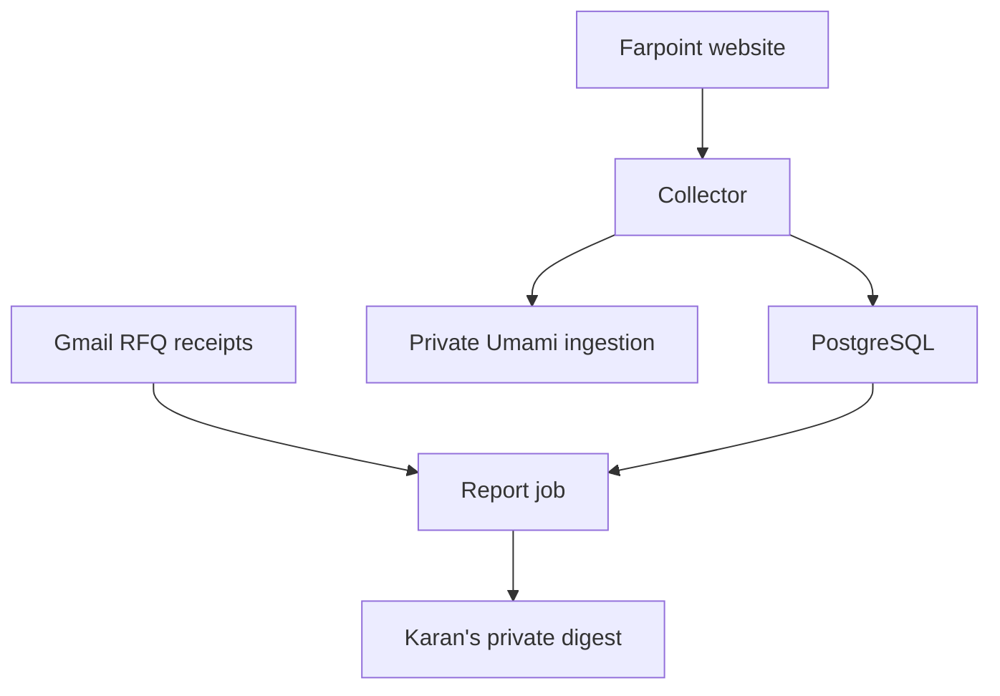

# Farpoint website lead intelligence — technical design

Version: 0.5, 22 October 2026 (America/New_York). Status: v0.4 approved before implementation; v0.5 implementation refinements awaiting final revision review.
Owner and sole authority over project goals: Karan Uppal.

## 1. Fixed goal and change control

Build operational website lead generation tracking and daily/weekly private reporting about who visited Farpoint, what is known about them, how they arrived, what interested them, and whether they became an inquiry. Use open-source software and a zero-subscription starting approach. Preserve the live website, product breadth, reference configurations, manufacturing responsibility, warranty, founder bio, and working quotation delivery.

Only Karan may change this goal. Reviewers may reject an incorrect mechanism, request stronger evidence, or identify an unmet requirement; they may not redefine the goal, substitute aggregate traffic for lead intelligence, waive required production verification, or call a blocked deployment complete. Unknown visitor identity is a measurement limit, not permission to invent a person or employer. The report must explicitly show anonymous/unmatched activity and the evidence behind each match.

The selected mechanisms are self-hosted Umami, a small Farpoint collector/reporting service, PostgreSQL, optional free company-network enrichment, and first-party RFQ identity from received email. Implementation choices may change under review without changing the goal. No paid subscription, paid identity graph, advertising pixel, session replay, or automatic prospect outreach is authorized by this design.

## 2. Current system and constraints

- `FarpointEnergy/farpointenergy.com` is a public GitHub repository, deployed through GitHub Pages. `content.py`, `build.py`, and `inquiry.py` generate static HTML. `README.md` and Privacy HTML are generated; edit their generator.
- Baseline production commit: `2b84ab5d84eba7cb7816c963bd45656ef24aa2a8`. The October 22 UTC release and an actual FormSubmit receipt to `quotes@farpointenergy.com` were verified. This alias delivers to Karan's Farpoint mailbox.
- FormSubmit remains the authoritative customer submission path, including native POST without JavaScript. Its explicit acceptance is distinct from actual inbox delivery. Existing 25-second timeout, uncertain-result duplicate guard, email fallback and field preservation remain intact.
- Existing analytics callback names: `product_path_view`, `rfq_start`, `rfq_submit_success`, `email_click`. Only product/application categories are emitted; there is no analytics destination.
- Public query values currently use narrow source/campaign/product/application allowlists. They are not general UTM capture.
- GitHub Pages cannot run the collector/database or scheduled reporting. No runtime credentials are present in the public repository. Connected Gmail tools do not provide a server-side OAuth token.
- Northflank currently shows a login screen in the available browser; authenticated deployment access is not yet established. This does not block design or implementation, but does block proving production deployment.

## 3. Architecture



Runtime services: Umami 3.4.0; Farpoint Node 24 collector/report service; PostgreSQL 15 (one instance, separate databases `umami` and `farpoint_leads`, separate login roles with access only to their own database). Pin images and record resolved digests at release. Collector is the only public write endpoint. Umami ingestion is reachable only from the collector; its dashboard is authenticated and has no public ingress. An operator may use an authenticated host port-forward to reach it; a public dashboard is not required for the private emailed report. No proxy exposes Umami routes. Test external reachability of Umami port 3000 and /api/send: both must fail; only the collector internal network can send events. Use TLS externally and authenticated/encrypted DB connections across host boundaries.

Collector has four independent responsibilities: validate events, persist lead evidence, forward sanitized analytics to Umami through a durable outbox, and optionally enrich network information. Report job reads records, imports relevant RFQ receipts, renders an HTML/text digest, and delivers it. Neither analytics failure nor database failure may affect FormSubmit or site navigation.

Northflank resource-count target: two services (Umami, collector), one PostgreSQL addon, two scheduled jobs (report and maintenance), initially within the advertised free allocation. Resource fit, storage, egress, startup migration memory and free eligibility must be measured in the account. If it does not fit, do not silently buy hosting or remove requirements: report the concrete constraint to Karan. Docker Compose provides a portable alternative and local integration environment.

## 4. Identity and evidence contract

| Evidence class | Meaning | Allowed statement |
| --- | --- | --- |
| `received_rfq` | A qualifying FormSubmit email was read from the Farpoint mailbox; contact fields were supplied by the submitter | "RFQ received from [supplied name/company]" (not independent identity verification) |
| `campaign` | Visit carried a recognized campaign code | "Activity attributed to campaign X"; never proof the addressed recipient personally visited |
| `network` | Validated source IP maps to a business-owned network | "Network associated with X"; inferred employer, not a named visitor |
| `anonymous` | Pseudonymous browser activity with no stronger evidence | "Anonymous browser visit" |

A browser ID identifies a consenting browser, not a person, household, employee, or cross-device identity. Shared computers, cookie removal, forwarding and scanners can split or misattribute activity. No merging solely on name, IP, guessed company, or geography. Join received RFQs to website events only with the exact random inquiry ID carried in the submitted form. Otherwise show the RFQ as received with unlinked attribution. Do not enrich personal addresses, private phone numbers, sensitive traits or non-business profiles.

## 5. Browser and event contract

Add a small dependency-free `analytics.js` before `inquiry.js`. Default configuration is disabled; enabled production config must have an HTTPS collector URL and explicit approved production hostnames. Preview/staging remains disabled unless explicitly using a separate QA collector. No destination, secret, or fake placeholder may masquerade as a live deployment.

Analytics uses explicit opt-in. A small accessible preferences panel offers Allow analytics / Decline, with a persistent footer control to change the choice; no preselected consent and no effect on RFQ use. Honor Global Privacy Control and Do Not Track by disabling collection. On withdrawal clear analytics identifiers and stop sending immediately. Consent is device-local, expires in 180 days; random browser ID expires in 30 days. Session ID expires after 30 minutes of inactivity. Storage failure means no persistent analytics. Do not transmit before consent. Reports describe consent-limited measurement; absence of events is not proof of absence of visits.

Events: `page_view`, `product_path_view`, `rfq_start`, `rfq_submit_success`, `email_click`. `rfq_start` means interaction with a quotation form, not a lead. `rfq_submit_success` means FormSubmit acceptance, not delivery. `email_click` means opening an email link, not sending email. Direct visits to thanks.html must never synthesize a successful submission.

Allowed envelope: schemaVersion=1; random eventId, browserId and sessionId; event name; allowlisted pathname; allowlisted product/application; recognized campaignCode; optional random inquiryId for accepted RFQ; optional allowlisted source/medium enums; sanitized external referrer hostname; language; screen class; client timestamp. Body maximum 4 KiB. Browser context objects never include names, emails, phone, requirement text, project references, specification URLs, raw full URLs, URL queries, hashes, full referrer URLs or arbitrary event properties. Server allowlist rejects unknown keys rather than trusting the client.

Use unload-safe `fetch(..., keepalive:true, credentials:'omit', referrerPolicy:'no-referrer')`; use sendBeacon only with site-wide no-referrer policy as specified in section15. Event UUID provides deduplication. No blocking await before RFQ redirect. Do not retry an uncertain event with a new UUID. Queue at most 20 sanitized events in memory; no queued form contents. The service acknowledges only committed events; a successful browser API call is not proof of receipt.

Campaign registry contains opaque public codes and private descriptive labels/account mappings on the server. Only registered codes and explicit `utm_source`/`utm_medium` enums are accepted. Never ingest arbitrary `utm_term`, `utm_content`, query strings or personal data embedded in URLs. Preserve registered campaign context for the consenting browser's 30-day window, with first and last recognized campaign recorded separately. Direct visits do not overwrite a known campaign. Internal link navigation and reference selection must remain independent of attribution.

Generate a random `Website inquiry ID` field in the form (no contact data) before submission, including native submissions when JavaScript runs. It is included in the FormSubmit email even if analytics is declined; in that case no visit history is collected. Preserve all existing 20 customer fields and Source/Campaign semantics. The analytics callback continues to receive only product/application; the adapter can read only the dedicated random ID field. A submission failure does not create a received-RFQ record.

## 6. API and ingress security

`GET /healthz`: minimal liveness; `GET /readyz`: DB connectivity and schema version without secrets. `POST /v1/events`: unauthenticated ingestion, strictly allowlisted Origin matching production/explicit QA hosts, correct content type, schema validation, bounded streaming body read, schemaVersion check, UUID validation, enum and pathname validation. Origin is an abuse reduction measure, not authentication; off-browser clients can forge it. Never treat browser-submitted values as trusted identity or proof of an actual sale.

`GET /v1/report?period=weekly|daily&date=YYYY-MM-DD`: authenticated, private, no-store report preview. `POST /v1/jobs/report`: authenticated scheduled execution. `GET /v1/status`: authenticated collection/forwarding/enrichment/delivery status. All admin APIs require a long random bearer secret stored only in runtime secret settings; reject query-string secrets. Compare secrets in constant time. Public routes have no report data, database errors or stack traces. CORS never uses `*` for reports.

Validate client IP only through an explicitly configured trusted proxy contract. Never trust arbitrary leftmost X-Forwarded-For. Northflank's documented header presence does not establish overwrite/append behavior. At deployment, send forged leftmost/rightmost/alternate IP headers and verify extraction. Until trust is proven, enrichment is unavailable and its acceptance gate remains open; do not silently call that feature complete. Strip all supplied forwarding/location headers on the collector→Umami request and construct trusted internal values only.

Rate-limit by short-lived keyed source-IP hash (where trusted) plus browser ID; cap event count per browser, request size and global daily event/enrichment budget. Use server receipt time for metrics; accept client time only within a bounded window as diagnostics. Known bots, explicit QA traffic and own visits are separated from prospect totals. Unknown scanners remain a stated limitation. Reject private/reserved IP lookups and guard against SSRF: enrichment host and Umami destination are fixed runtime configuration, never supplied in an event.

## 7. Storage, outbox and retention

Use parameterized SQL and versioned transactional migrations. Tables:
- `events`: unique event_id; received_at UTC; event_name; page; browser_id; session_id; product/application; recognized campaign; inquiry_id; referrer_host; quality flags; network evidence reference.
- `network_cache`: HMAC lookup key, normalized company/domain/network type and provider, lookup timestamp and expiry, flags. Do not persist raw IPs; lookup happens during the request with a strict timeout or within an encrypted short-lived queue if later adopted. Default implementation performs a bounded two-second lookup before committing the event response, after reserving quota atomically, without storing the raw IP. If the process dies, the reservation is consumed and the browser event may be absent; retry with the same event UUID is safe. If lookup fails, persist an explicit unavailable reason and continue event commit. There is no supposedly durable background IP lookup.
- `analytics_outbox`: sanitized Umami payload, stable source event ID, attempts, next attempt, status. Unique event ID; retries exponential with jitter, bounded. Umami may not support deduplication, so do not claim exactly-once delivery to it. Lead report counts use authoritative local event IDs.
- `rfq_receipts`: Gmail message ID unique; received timestamp; normalized inquiry ID; supplied name/company/business email; selected product/application; project summary/reference and remaining submitted fields as supplied; no attachments downloaded.
- `report_deliveries`: unique period/cadence/recipient; interval boundaries; state prepared/sending/provider_accepted/inbox_verified/uncertain/failed; stable Message-ID; digest hash; Gmail outbound ID when returned; attempt times.

Raw events and linked inquiry snapshots: 90 days default; daily aggregate counts: 13 months; network cache: 7 days; source-IP rate hashes: one day; sent report delivery ledger: 13 months without report body. Gmail remains the customer correspondence source of record. Deletion removes browser events, corresponding outbox, linked receipt snapshots and replicated Umami rows when requested; section15.6 defines the independent deletion journal, replay suppression and backup-restore procedure. No database contents, receipt bodies, report HTML, tokens or identifiers are committed to the public GitHub repository. Example reports use explicit synthetic data.

## 8. Umami integration

Pinned 3.4.0 source has now been verified. POST /api/send accepts `{type:"event", payload:{website:<configured UUID>,hostname:<approved host>,url:<allowlisted pathname>,referrer:<sanitized origin>,id:<random browser UUID>,name:<event name>,data:<allowlisted categories>,timestamp:<server Unix seconds>}}`. Omit name for page views. There is no visitorId property. Payload id becomes distinctId (maximum 50 characters); Umami session IDs additionally incorporate IP, user agent and a monthly salt, so Farpoint browser/session counts come from its own event store. Body ip and userAgent override headers without authentication; only the collector may construct those fields from trusted ingress data. Never expose this endpoint directly to untrusted traffic. A 200 with beep/boop is bot suppression, not proof of a persisted event; track that separately. The endpoint has no source-event deduplication key. Do not rely on TRUSTED_PROXIES (documented for 3.5.0). Collector sends sanitized page URL (path only under approved hostname), sanitized referrer, bounded language/screen and event categories. Browser identity/visit semantics must be explicitly verified against the pinned implementation; do not use a shared proxy IP as visitor identity or location. Forward with distinctId plus unspecified0.0.0.0 as specified in section15.2; the Farpoint store owns browser/session counts. Umami is a useful interactive analytics dashboard, while the Farpoint event store is authoritative for deduplicated lead counts and report joins. Monitor outbox lag and surface failed forwarding. Umami being unavailable must not stop ingestion or inquiries.

## 9. Company enrichment

Default zero-subscription provider: optional ipapi.is free account, capped below its 1,000/day allowance (900) and cached. API credentials are server-only. Retain only business network/company/domain, coarse country/region and reliability flags; discard abuse contacts, street addresses and exact coordinates. Residential ISP, mobile, hosting, VPN, Tor, proxy and ambiguous results remain anonymous/network-unknown, not qualified buyers. Corporate network matches are inferred and do not name people. A target-buyer classification uses explicit private domain/account registry, never treats an ASN owner such as Amazon or Microsoft as a customer automatically.

Fully local alternative: downloaded IPtoASN PDDL dataset and BSD self-host lookup. It identifies network owners, offers less classification, and needs additional exclusion rules. It does not satisfy named-person identification. Track lookup coverage, failures and stale results. No claimed match rate before real traffic. The Privacy page must accurately disclose the deployed provider and sharing, including IP lookup if enabled.

## 10. RFQ import and report delivery

Use a dedicated Google OAuth client authorized by Karan for Gmail read and send, with refresh token/client secret stored in host secrets, never repository or chat. Existing Gmail connector authorization does not imply this credential exists. Prefer OAuth to a broad app password; ordinary account passwords are forbidden. The importer queries only FormSubmit messages addressed to the quote alias, verifies expected sender and message headers under the strict rules in section 15, and parses their tabular fields. Sender text alone is not authentication; require trusted Gmail authentication evidence; missing/failed/ambiguous evidence is quarantined and excluded from received-RFQ totals. Re-read a seven-day overlap and deduplicate by Gmail message ID; support a bounded initial 90-day import. Exclude the explicit Farpoint QA prefix from production lead counts.

Reports include total consenting browser activity; new/returning browsers where 30-day ID allows; candidate accounts with evidence; pages and dates; campaign source and first/last touch; accepted RFQs vs received RFQs; email-link clicks; buyer-fit rationale; recommended manual next action; unmatched traffic; missing-data/collector/enrichment/import health. Never send automatic sales follow-up. Known contact details appear only in Karan's private report and protected data store.

Cadence: configurable daily and weekly, initial weekly Monday morning America/New_York to Karan's Farpoint mailbox. Report interval is the previous full local calendar week (Monday 00:00 through following Monday exclusive), or previous local calendar day. Store UTC interval bounds, handle DST using IANA timezone, and test spring/fall transitions. Empty healthy intervals produce a short zero-activity report; unhealthy intervals say data incomplete, never zero visitors.

Deliver through Gmail API with a stable RFC Message-ID. Persist `sending` before transmit. If API returns a message ID, persist provider_accepted (not inbox_verified); if outcome is ambiguous, search Sent by Message-ID and reconcile. Do not blind resend uncertain deliveries. Distributed DB locking plus unique period key prevents concurrent duplicates. Retries on explicit failures only. Do not mark delivery verified until a unique test digest is visible in the recipient inbox. Configure native scheduled job Forbid concurrency; manual invocations still use DB guard.

## 11. Website integration and user experience

No redesign. Add deferred analytics/config assets, minimal accessible preference control, optional non-sensitive inquiry ID hidden field, and accurate Privacy disclosure. Preserve quotation opening copy, mailto links, optional collapsed technical fields, input retention, references and native POST. A collector timeout, blocked script, denied consent, storage exception or ad blocker must leave the RFQ fully usable. Prevent duplicate listeners/page views on bfcache restores. Analytics preference controls support keyboard, focus restoration, screen readers and narrow mobile widths. Company data, dashboards and reports are never added to public navigation.

## 12. Validation and acceptance matrix

| ID | Required evidence |
| --- | --- |
| A1 | Independent staff reviewer approves a concrete design revision; goals unchanged; all blocking design findings resolved. |
| A2 | Existing reproducible build/site/context/inquiry checks pass without weakening baseline invariants. |
| A3 | Browser client: no sends before opt-in, opt-out/GPC/DNT honored, disabled/preview modes silent, no PII/raw URL/referrer leakage, malformed campaign rejected. |
| A4 | Reference selection and typed requirements survive analytics events and RFQ failures; native POST still works. |
| A5 | Desktop and mobile browser QA verifies preference controls, layout, accessibility and RFQ usability. |
| A6 | Real HTTP service tests prove schema/body limits, hostile input, exact-origin allowlist, admin auth, parameterized persistence, dedupe, rate caps and no error leakage. |
| A7 | Real PostgreSQL integration proves migrations, concurrency, restart persistence, unique IDs, outbox and report locks; mocks alone do not pass. |
| A8 | Pinned Umami receives sanitized QA events; counts/identity semantics verified; unavailable Umami leaves collector and RFQ working. |
| A9 | Enrichment tests: residential/mobile/hosting/VPN unknown, business evidence labeled inferred, quota/timeout/cache handling, no raw IP retention. |
| A10 | Deployed proxy spoof tests prove the source-IP trust contract before company identification is enabled. |
| A11 | Real Gmail RFQ receipt imports all submitted fields; received vs accepted vs email-click counts remain distinct; QA excluded. |
| A12 | Report tests cover exact NY calendar intervals/DST, empty vs unhealthy, deduped receipts, anonymous coverage, attribution evidence, HTML injection, recipient validation, no PII in logs. |
| A13 | Crash/timeout/concurrent-send tests prove stable Message-ID and uncertain-delivery reconciliation. |
| A14 | Real scheduled-runtime test sends one unique digest and verifies actual inbox receipt; scheduler configuration read back. |
| A15 | Production config points only to real healthy endpoints; backups/restore, retention, secrets, costs and health verified. Erased/expired identifiers disappear from both databases, including Umami dependent rows; outbox retries, RFQ reimport and restoration of a pre-deletion backup cannot recreate them. |
| A16 | Final independent implementation review approves exact tested revision; deployment and post-release tests recorded. |

Unit fixtures and mock delivery are explicitly separate from real provider or inbox tests. A missing host login, unproven proxy, absent OAuth credential or incomplete acceptance row remains an open release gate; it cannot be converted into a pass by a reviewer. Partial development can be saved in a draft PR with disabled production configuration, but that is not completion of the fixed project goal.

## 13. Release, rollback and operations

1. Approve design before implementation. Record review rounds in `docs/lead-intelligence-review.md`.
2. Implement on an isolated branch; pin dependencies; add checks, synthetic fixture reports and deployment/runbook files.
3. Deploy isolated backend/database; establish authentication, resource fit and client-IP trust. Run real integration and delivery tests with QA excluded from business metrics.
4. Open PR with browser-accessible preview and test evidence. Run independent staff implementation review. Revise until blockers are resolved.
5. Deploy website config only after backend is ready, scheduled delivery is proven and Privacy copy matches active behavior. Verify public page bytes, consent behavior, real event ingestion and unchanged quote delivery.
6. Roll back client config to disabled first, leaving the quotation flow intact. Preserve database for diagnosis; disable report jobs if producing incorrect output. Restore from tested backup if needed. No destructive schema migration in this release.

Health: last accepted event, outbox lag, last RFQ import, last successful report/inbox verification, enrichment failure/quota, DB/storage/resource usage. Freshness thresholds are explicit and reports surface missing data. No visitor traffic is not itself an outage. A synthetic tagged QA probe verifies collection without inflating sales metrics. Backup encrypted database snapshots, test restore, retain limited history; schedule deletion and quota checks.

## 14. Evidence and unresolved deployment dependencies

- Umami source and release: https://github.com/umami-software/umami/tree/v3.4.0
- Umami self-host scheduled reporting: https://docs.umami.is/docs/guides/automate-reporting-with-api
- Northflank deployment guide: https://docs.umami.is/docs/guides/running-on-northflank
- Northflank current free resource allowance: https://northflank.com/pricing
- Northflank forwarding-header docs: https://northflank.com/docs/v1/application/network/networking-on-northflank
- Northflank jobs: https://northflank.com/docs/v1/application/run/run-an-image-once-or-on-a-schedule
- ipapi.is output, free allowance/commercial use: https://ipapi.is/ and https://ipapi.is/pricing.html
- Fully local dataset: https://iptoasn.com/

Design-review findings and their concrete resolutions are recorded in section 15 and the review log. Open before live release: Northflank sign-in and free resource allocation, trusted proxy test, dedicated Gmail OAuth grant, test inbox delivery, real browser QA and independent implementation approval. No runtime credentials or paid services have been provisioned.

## 15. Concrete contracts and first staff-review resolutions

### 15.1 API schema and identity lifecycle

All UUIDs are canonical UUIDv4 strings (36 characters). Fresh event UUID per user action; exact same UUID reused for a retry. Server inserts `ON CONFLICT(event_id) DO NOTHING`; an identical repeat returns 202 with duplicate=true, while the same ID with different canonical payload returns409 and never mutates the record. Store a SHA256 canonical payload hash. All unknown keys reject400. Page is one of the generated site's canonical route paths (root normalized to /index.html); no query/hash/percent-encoded dynamic path accepted. Event/product/application enums mirror the existing source allowlists; absent product/application becomes unsure. Campaign codes come only from server/browser registry; source enum is email/search/social/referral/direct; medium enum is email/organic/social/referral/none. A campaign+source+medium combination must match its registry entry, otherwise reject. Referrer is empty or an allowlisted well-known source hostname; arbitrary hostnames are replaced with other (to avoid personal identifiers/subdomains). Language is one of supported broad two-letter language codes or other; screen class mobile/tablet/desktop, never exact dimensions. Client timestamp must be an integer within24hours; it never selects report period. Inquiry ID is accepted only for rfq_submit_success and is random, not an RFQ project name. Public event request timeout5seconds; total body4KiB. Authenticated report-job requests have a separate120-second response budget; the importer has a90-second budget and durable resumable cursor. A timeout is never reported as completed work.

Browser state is one JSON localStorage value with explicit version, consent expiry, browser expiry, session lastActivity, firstCampaign and lastCampaign. Validate every field when reading; reject tampered/expired structure. Browser ID rotates30days after creation; its previous browser relation is deliberately unavailable. A new session starts after30minutes. The report says new/returning *within the available30-day browser window*. No storage permission or crypto means no persistent analytics and the form remains functional. Inquiry ID is generated at form initialization, reused for retries of the same attempt and never regenerated while sending/uncertain. It is a hidden form metadata field, never a way to rewrite customer inputs. Client callback exceptions remain isolated.

Browser event transport uses fetch keepalive with no-referrer and omit credentials when available; sendBeacon is the fallback only under a site-wide no-referrer policy, because sendBeacon lacks a referrerPolicy argument. No raw page URL is transmitted in an HTTP Referer header. Prefer no-referrer on all analytics requests and retain existing customer form policy. No persistent event queue; memory cap20; do not retry beyond page lifetime, expose measurement limitations. A successful browser transport call is not server persistence evidence.

### 15.2 SQL indexes, outbox and limits

Versioned migrations create primary keys on event UUID, network cache HMAC, Gmail message ID, and delivery key. Index events on(received_at),(browser_id,received_at),(session_id),(inquiry_id),(campaign_code,received_at); timestamps are timestamptz. CHECK enums, nonnegative counters and bounded strings in addition to app validation. Receipts store fields as a size-bounded JSON object and parsing status, with no uniqueness constraint on inquiry_id (two different emails can legitimately repeat one inquiry); a repeated inquiry ID links to one browser only if unambiguous, otherwise attribution is quarantined. Job locks use Postgres session advisory locks on dedicated connections, released in finally/on connection loss. The PG application role is not superuser and cannot access the Umami database. A separate maintenance-only role may SELECT/DELETE the pinned Umami analytics tables for section15.6; its credential is not available to public ingestion, report generation or the ordinary outbox worker.

Outbox insert is in the same transaction as event insert. Worker claims due rows using FOR UPDATE SKIP LOCKED and a two-minute lease; it commits the lease before network I/O and updates only its lease token afterward. Reclaim expired leases; maximum10attempts, exponential backoff min30seconds max6hours plus jitter, then dead_letter. HTTP2xx with expected session/visit response = forwarded; known beep/boop = suppressed; rejected4xx = dead_letter except429;429/5xx/timeouts retry. Ambiguous retries can duplicate Umami events; the deduplicated Farpoint database is authoritative and reports say so. Never store or forward raw IP in the outbox; if an event needs an IP for real geolocation, send it transiently on initial attempt and record geolocation unavailable on later retries, rather than substitute the collector's network as visitor location. For consistent outbox semantics, initial implementation sets Umami IP to the reserved unspecified address0.0.0.0 and uses random payload.id; Umami geographic reports are explicitly unavailable. Explicit empty browser/os overrides prevent a generic forwarding user-agent from fabricating Chrome/Linux visitor details. Company evidence is independently derived from validated ingress before persistence. This avoids storing raw visitor IP and incorrect proxy geography.

Limits: max120events/browser/minute, max600events/trusted-source-HMAC/minute, global20,000events/day and900enrichment lookups/day. Daily quota uses a transactional date-keyed counter, not in-memory only. Return429 with Retry-After when exceeded; client does not aggressive-retry. Do not let a spoofed Origin bypass schema/limits. Set DB statement_timeout5seconds, pool max5 collector plus2job connections, max20 on Umami initially. Drop oversized/invalid requests before DB. Enrichment cache TTL7days; provider error/timeout negative cache15minutes; quota reservation happens in a DB transaction before lookup, so crash cannot exceed limit. HMAC secret rotation invalidates cache and limiter; never log source IP. Host/provider access logs may still contain IPs: disable/redact configurable access/request-body logs and describe provider logs accurately; do not promise no IP is retained by the hosting provider.

### 15.3 Gmail import and delivery state machine

Only import from mailbox karan@farpointenergy.com, exact envelope/header From submissions@formsubmit.co, and exact To/Delivered-To quotes@farpointenergy.com. Read Gmail API full representation and internalDate (not sender Date) as receive time. Inspect the first Authentication-Results header inserted by Gmail with authserv-id mx.google.com, positioned with Gmail's leading received headers; require dmarc=pass header.from=formsubmit.co and dkim=pass aligned to formsubmit.co. Missing/duplicate conflicting trusted results, duplicate From/To, oversized message/body, unrecognized template or conflicting duplicate field keys are quarantined. Never accept a body/attached message's fake authentication header. Restrict importer query and paginate all results up to explicit1000messages/run; reaching cap means incomplete, not successful zero. Seven-day overlap plus checkpoint, 90-day bounded initial backfill. Check Gmail profile email before reading/sending and refuse wrong account. OAuth scopes gmail.readonly and gmail.send only; use Farpoint Workspace internal OAuth app where available, avoiding an external Testing grant that expires after7days. New grant requires Karan's account approval and is an explicit deployment gate.

Parse the FormSubmit HTML table structurally (HTML parser, never execute HTML), exactly two cells per data row, approved field-name allowlist covering all20customer fields plus Source/Campaign/Website inquiry ID. Preserve text and preformatted line breaks, decode entities once. Unknown noncustomer fields ignored with diagnostic count; missing required Name/Company/email/Requirement quarantines. Malformed inquiry UUID means unlinked RFQ, not a fabricated join; duplicate conflicting IDs quarantine attribution. Cap total decoded body256KiB and each field according to the existing form limits. The matched sender/domain proves delivery through FormSubmit, not truth of visitor-supplied identity. Never fetch specification URLs or remote images.

Recipient and sender are fixed to karan@farpointenergy.com, configurable only through validated deployment config (exact allowlist); API callers cannot override recipients. Reject newline/control characters in email headers and HTML-escape every field. Reports include professional fields necessary for followup, with requirements kept in a bounded summary and link to the original Gmail message rather than copying all private technical detail into the digest. Full imported fields remain protected for faithful preservation checks.

Delivery key=`cadence:local-period-start:recipient`; unique DB row and session advisory lock. prepared→sending is committed before HTTP send; stale sending becomes uncertain. Gmail request timeout15seconds. HTTP4xx other than408/429 is explicit failed (authorization failure surfaced);408/429/5xx/connection reset/timeout/malformed success is uncertain. A 2xx with message ID becomes provider_accepted. Reconcile uncertain using authenticated Sent search by stable rfc822msgid after2minutes, up to24hours with bounded attempts; zero search results do not prove non-send, so remain uncertain and require operator decision before resend. Matching Sent message→provider_accepted. Inbox verification separately requires same Message-ID, expected recipient, INBOX label and matching subject/body digest; it alone sets inbox_verified. A provider_accepted report remains distinct from inbox_verified. Manual and cron runs share the same lock/idempotency key. Render/body hash is stored only in the ledger; report content stays private.

### 15.4 Runtime, health, retention and recovery

Initial allocation target: each of Umami, collector and Postgres512MiB, small shared CPU; jobs limited to512MiB. This is a measured proposal, not a claim of free capacity. Record account quote before deployment; keep no-card/free configuration and refuse paid upgrades. One Postgres instance, two databases/roles, initialized by a one-time owner provisioning step; application secrets contain only own database credentials. Run migration job once with advisory lock before service rollout; do not have replicas racing startup migrations. Backups: encrypted daily snapshot, a strict seven-day retention cutoff (8 daily sets at the boundary;9-set transient peak before pruning), off-instance storage subject to measured aggregate free allowance; restore to isolated database and compare row counts/constraints before release. OAuth and host secrets are set only through secure provider controls.

Scheduler wakes hourly at minute17 UTC, then job checks NY local weekday/hour and last delivery key; weekly due Monday08:00 NY, daily due08:00 NY, with six-hour catchup window. Initial WEEKLY enabled; daily configurable without code changes. This handles DST without shifting local morning. Maintenance daily at05:17UTC. Outbox drain runs every30seconds with lease guard. RFQ importer runs before each report and on hourly job, so missing inbox authorization is visible. Status thresholds: outbox oldest pending>15minutes degraded; deadletter>0 degraded; RFQ last successful import>2hours degraded; scheduled report due+2hours unsent degraded; daily synthetic probe older26hours degraded; DB unavailable unhealthy; enrichment quota>90% warning. No visits alone never marks service unhealthy. Digest must include degraded reasons and never equate missing data with zero visitors.

Retention job deletes expired raw events/outbox/receipt snapshots and replicated Umami analytics after90days, cache after7days, limiter after1day, aggregate/ledger after13months; backups expire7days. Section15.6 specifies the independent100-day deletion journal/tombstones and replay before any restored service starts. Aggregate counts cannot recover deleted identities. A rollback disables website analytics config first, then pauses jobs while preserving DB. Test failure injection for DB restart, host crash during outbox/send, provider timeouts, bad credentials and exhausted quota. Native Postgres service integration in CI is mandatory if the local container cannot run a nonroot PostgreSQL server; PGlite/mocks are development aids, not substitutes for production-parity acceptance.

### 15.5 Metric, rollup and quality semantics

Canonical event counts use distinct event_id in Farpoint Postgres, never Umami totals. Visits=distinct session_id with at least one page_view in interval; browsers=distinct browser_id; new browser=its earliest retained event falls in interval, explicitly within90-day retained records and30-day identifier lifetime. Returning browser=observed before interval with current ID; browser is not a person. Pages=page_view count; RFQ starts=distinct session_id with rfq_start; accepted inquiries=distinct valid inquiry_id on rfq_submit_success within interval, and successful events lacking inquiry_id are shown separately as unlinked acceptance events. Received RFQs=unique authenticated Gmail receipt messages in interval (Gmail internalDate), with repeated inquiry IDs flagged as possible duplicate receipts and no assertion of separate opportunities. Matched received leads join only unambiguous inquiry IDs. Conversion rates use only consenting sessions with an observed page_view in the interval as the denominator cohort; the numerator is the subset of those same sessions with starts/accepted submissions in the interval. A start/acceptance whose page_view was lost is reported separately and cannot make conversion exceed100%; received RFQs may include nonconsenting traffic, so do not divide all receipts by consenting sessions and call that site-wide conversion. Show received counts separately; no numerator/denominator mixes.

Add daily_aggregates primary key(local_day,metric,dimension_key); fields value bigint>=0,computed_at timestamptz,source_complete boolean. Use NY calendar dates, dimension_key all or registered campaign code (no browser/contact/network identifiers). Metrics page_views,sessions,browsers,rfq_start_sessions,accepted_inquiry_ids,unlinked_acceptances,received_receipts,duplicate_inquiry_receipts,email_clicks. Nightly maintenance recomputes each day in trailing90days from canonical raw tables and UPSERTs replacements in one transaction per day under advisory lock; never increment on retry. Backfilled receipts update historical buckets by internalDate, not import date. Roll up before retention deletion; commit a monotonic raw-retention cutoff in the same transaction as deletion. Never overwrite an existing daily bucket from a day whose beginning precedes that cutoff; its source is already partial. Freeze already-computed older buckets and retain13months. Daily unique sessions/browsers/inquiry counts are not additive over days; historical graphs label them per-day counts and never sum them into unique weekly/monthly people. Recent weekly reports calculate directly across raw rows for exact distinct counts. Incomplete importer/collector intervals set source_complete=false and retain the specific reason.

QA is assigned by server environment (isolated QA DB) or authenticated synthetic-probe job, never an arbitrary public event property. Explicit FARPOINT-QA- project references flag test RFQ receipts and exclude them from all business aggregates. Self-exclusion is an explicit local preference accessible through the analytics control; it disables sends and is separate from the customer's consent choice. Real production probes use an authenticated server job through public ingestion, require a separate configured Umami QA website UUID, test downstream components, and cannot inflate either Farpoint business totals or the production Umami dashboard. Both Umami websites receive90-day retention. Data from blocked/declining visitors is not estimated as measured traffic.

The client must handle consent granted after pre-consent rfq_start: track only the first subsequent consented interaction, without replaying prior actions; maintain consent-period start guard in analytics adapter rather than relying solely on inquiry.js started flag. Browser-ID expiry clears both first/last campaign attribution and session state. Report direct/no-known-campaign separately rather than labeling it an organic source.


### 15.6 Complete deletion, Umami retention and restore exclusion

The pinned source for this contract is Umami v3.4.0 `prisma/schema.prisma`, `src/queries/prisma/session.ts` and `src/queries/prisma/website.ts`. Prisma uses `relationMode = "prisma"`: direct SQL must explicitly delete dependents, not assume database cascades. Browser payload.id is stored in `session.distinct_id`; `session_link` can contain additional session associations. For erasure, collect sessions matching the browser ID through either table and defensively through `session_data.distinct_id`, always restricted to Farpoint's configured website UUID. Session children are `website_event`, `session_data`, `session_link`, `revenue`, `session_replay`, and `heatmap_event`; event children are `event_data.website_event_id`; saved replay metadata links through `session_replay_saved.visit_id`. Replay, heatmap, revenue and identify/session-data collection remain disabled, but deletion covers their tables so an empty-table assumption cannot leave records behind.

**Shared exclusion contract.** Create `system_state(key text PRIMARY KEY, value jsonb NOT NULL)` with `privacy_maintenance` value `{"active":false}`, and `privacy_tombstones(kind text CHECK (kind IN ('browser','gmail','inquiry')), key_hash char(64), expires_at timestamptz NOT NULL, PRIMARY KEY(kind,key_hash))`. Hashes are lowercase hex HMAC-SHA256 with a dedicated stable `DELETION_HMAC_KEY`, over `kind + ':' + normalized ID`; normalize browser/inquiry IDs as canonical UUIDv4, and use the exact Gmail API message ID for gmail. Never put raw IDs in tombstones or logs. Keep this key available across restoration and rebuild tombstones from the independent encrypted journal before rotating it.

All event-ingestion, RFQ-import and report-generation transactions acquire a shared advisory lock `(7104,1)`, then check the maintenance gate and applicable unexpired tombstones. Event insertion checks browser and optional inquiry; receipt import checks both Gmail message ID and any valid inquiry ID. Gate active means return a generic503/Retry-After for collection or defer a job; a tombstoned event is silently ignored with202 and no insertion, and a tombstoned receipt is skipped. Outbox sends acquire the same shared session lock on a dedicated connection, recheck gate, source-event existence, browser/inquiry tombstones and source age, and hold the lock across the bounded HTTP attempt. Expired, erased or missing-source rows are deleted without forwarding. No source event older than48hours is forwarded; an exhausted delivery becomes dead_letter and health exposes the gap. This age bound is separate from the90-day raw-data retention period. The maintenance runner takes the exclusive version of the same lock and leaves the persistent gate active if interrupted. Normal workers never clear it automatically. Lock order is privacy shared lock before existing report/import/outbox locks to avoid inversion.

**Independent deletion journal.** A rare operator-authorized erasure is a maintenance command, not a public endpoint. Before deleting either database, write an authenticated-encrypted immutable record to the already-required off-instance backup store, under a separate `deletion-journal/` prefix that snapshot restoration never replaces. Use a random request UUID, format version, request time, Farpoint website UUID, exact browser IDs plus linked inquiry IDs and Gmail message IDs, and no customer form content. Discover linked IDs before deletion. Each record is encrypted with AES-256-GCM and a fresh nonce using a backup/journal key held in provider secrets; write then read back and verify its authenticated plaintext/hash. An append-only completion record references the request UUID. Provision an encrypted manifest once, bound to the production website UUID and a stable installation UUID. Its compare-and-swap protected inventory records request UUIDs, requested times and content hashes. A verified request object must be registered by conditional manifest update and read back before either database is deleted. Recovery fetches every unexpired indexed object and verifies its hash; a missing object, namespace mismatch or unavailable manifest fails closed. Object listing alone is not proof of a complete journal. Expired entries are pruned by CAS after100days; the manifest itself never expires. The provider must implement tested If-None-Match/If-Match and strong read-after-write semantics. The private object listing and object read/write/durability behavior must be verified for the selected free storage provider before A15 passes. A missing/unreadable journal or failed verified write leaves the request incomplete and services gated; never acknowledge erasure as completed. Existing Gmail customer correspondence and already-delivered digests remain in Karan's mailbox; this command erases the analytics copies, and does not silently delete business email.

Retain journal records and corresponding tombstones100days from the erasure request, which exceeds the90-day importer/backfill window and seven-day backup lifetime. The importer must never reimport messages older than90days, even if a stale checkpoint requests them. Retention expiry does not need per-person journal records: restoration always reruns current retention before service startup. Store deletion status/counts without identifiers in operational health; no journal, tombstone input or maintenance output containing identifiers goes into Git.

**Rare erasure sequence and the in-flight race.** Under the exclusive privacy lock, commit gate active, write/read-verify the journal, and UPSERT all browser/inquiry/Gmail tombstones. Pause the private Umami service through hosting controls and confirm all Umami instances/processes have stopped; a failed health request alone is insufficient evidence. This step is necessary because a timed-out HTTP send can still be executing remotely after its worker releases a lock. Ingestion and jobs remain gated. Delete corresponding Farpoint outbox/events/linked receipt snapshots, and execute the Umami transaction below using the maintenance-only credential. Recompute affected recent aggregate days from remaining rows; previously anonymized aggregates may remain. Verify zero matches in both databases, restart Umami, check private health, write/read-verify the completion journal record, then commit gate inactive and release the lock. If anything fails, keep gate active and rerun the idempotent command; the quotation form remains usable throughout. Do not report erasure complete until both database checks and journal completion succeed.

The following SQL describes the exact v3.4.0 erasure operation. Run it inside one transaction on the Umami database with a fixed application-controlled schema/search_path, parameter `$1::uuid` = configured Farpoint website, `$2::text[]` = browser UUIDs from the authenticated journal. Identifiers/table names are fixed code, never request parameters. `event_data` deletion follows its actual parent key even if a duplicated website_id drifted, matching Umami's own safety pass. Temporary tables are connection-local and dropped on commit.

```sql
BEGIN;
CREATE TEMP TABLE purge_sessions ON COMMIT DROP AS
  SELECT session_id FROM session
    WHERE website_id=$1::uuid AND distinct_id=ANY($2::text[])
  UNION SELECT session_id FROM session_link
    WHERE website_id=$1::uuid AND distinct_id=ANY($2::text[])
  UNION SELECT session_id FROM session_data
    WHERE website_id=$1::uuid AND distinct_id=ANY($2::text[]);
CREATE TEMP TABLE purge_events ON COMMIT DROP AS
  SELECT event_id, visit_id FROM website_event
  WHERE website_id=$1::uuid
    AND session_id IN (SELECT session_id FROM purge_sessions);
CREATE TEMP TABLE purge_visits ON COMMIT DROP AS
  SELECT visit_id FROM purge_events
  UNION SELECT visit_id FROM session_replay WHERE website_id=$1::uuid
    AND session_id IN (SELECT session_id FROM purge_sessions)
  UNION SELECT visit_id FROM heatmap_event WHERE website_id=$1::uuid
    AND session_id IN (SELECT session_id FROM purge_sessions);
DELETE FROM event_data WHERE website_event_id IN
  (SELECT event_id FROM purge_events);
DELETE FROM session_replay_saved WHERE website_id=$1::uuid
  AND visit_id IN (SELECT visit_id FROM purge_visits);
DELETE FROM session_replay WHERE website_id=$1::uuid
  AND session_id IN (SELECT session_id FROM purge_sessions);
DELETE FROM heatmap_event WHERE website_id=$1::uuid
  AND session_id IN (SELECT session_id FROM purge_sessions);
DELETE FROM revenue WHERE website_id=$1::uuid
  AND session_id IN (SELECT session_id FROM purge_sessions);
DELETE FROM session_data WHERE website_id=$1::uuid
  AND session_id IN (SELECT session_id FROM purge_sessions);
DELETE FROM session_link WHERE website_id=$1::uuid
  AND session_id IN (SELECT session_id FROM purge_sessions);
DELETE FROM website_event WHERE event_id IN
  (SELECT event_id FROM purge_events);
DELETE FROM session WHERE website_id=$1::uuid
  AND session_id IN (SELECT session_id FROM purge_sessions);
COMMIT;
```

**Nightly retention.** Use one fixed UTC cutoff `maintenance_started_at - interval '90 days'` and the same exclusive privacy lock. Cancel expired Farpoint outbox rows before any source-event deletion. In Umami, stage expired `website_event.event_id`/visit IDs with `created_at < cutoff` (NULL timestamps are invalid and purged), remove their `event_data` by actual parent key, then delete those events. Also remove old/NULL-created rows from event_data, session_data, session_link, revenue, session_replay_saved and session_replay, plus old heatmap_event rows, always scoped to the configured website. Finally stage old/NULL-created sessions that have no remaining website_event, session_data, revenue, session_replay or heatmap_event child, and remove any residual session_link followed by session. The dependency order and scoped predicates are the same as the erasure SQL; retain a session with a newer event rather than deleting that newer event. Forwarding is restricted to48-hour-old or newer events, so an outbox retry cannot reintroduce a90-day-expired event; retained Umami writes receive the original authoritative event receipt timestamp. If unresolved forwarding is old enough to violate that invariant, perform the stopped-Umami procedure before retention. Database timestamp limits and session orphan checks must be exercised on the pinned real schema, not a simplified mock.

**Restore procedure and acceptance.** Stop collection/jobs/Umami before restoring either database. Force gate active before starting any ordinary worker. Read and authenticate all unexpired independent journal requests, including requests lacking completion markers, reconstruct tombstones, and replay their idempotent deletions against both restored databases; do not use only the journal copy contained in a database backup. Run current retention, recompute affected recent aggregates, and verify each requested identifier is absent. Restart services and clear the gate only after successful verification. A15 tests must cover erasure with a claimed outbox row, an ambiguous already-started Umami request, seven-day RFQ overlap and90-day backfill, a crash between the two database commits, a pre-erasure backup restore, journal read/write failure, correct deletion of dependent rows, and preservation of an unrelated browser/site. Passing design review authorizes implementing this contract; it does not claim any of these live checks already passed.

### 15.7 Implementation-review refinements

These corrections preserve the fixed goal. Report rendering has a byte budget below its own MIME verification limit, with explicit omitted-content counts and a private source link. Reconciliation selects eligible, bounded-age work separately from manual-required stale deliveries, so unresolved rows cannot starve newer inbox verification; no ambiguous message is automatically resent. Gmail import keeps a durable fixed scan window/cursor, distinguishes completed coverage from job freshness, resumes within a bounded budget, and can restart the same window on explicit invalid-token rejection while preserving message-ID deduplication. Native PostgreSQL tests must verify these refinements before final implementation approval.

Maintenance destructive privileges are limited to the nine analytics tables; read access needed for encrypted database snapshots does not grant DELETE on users, API keys or app settings. The operational journal uses a stable installation UUID and CAS inventory, as specified above. Real host, Gmail, source-IP, storage and inbox evidence remain required; none of these implementation improvements changes the goal or waives a release gate.
